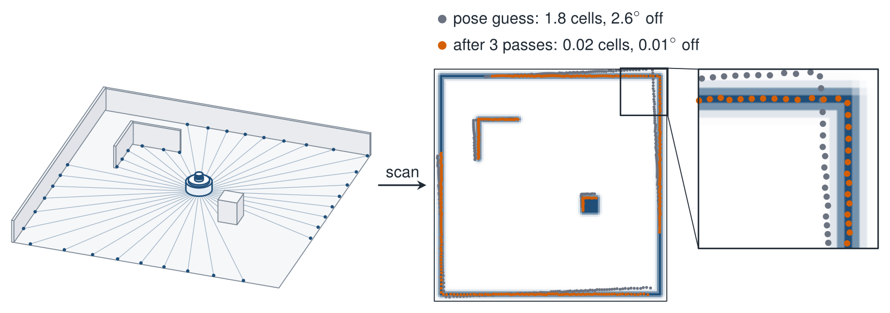

# Scan-Matching Accelerator

FPGA logic that takes over the per-point arithmetic of 2D LiDAR scan matching on a ZCU104 board (Zynq UltraScale+ MPSoC). A mobile robot matches every new scan to its occupancy grid map to know where it is, and every pass of the matcher repeats the same arithmetic for every scan point. The logic computes that part, and the ARM cores keep the work done once per pass.



On the ZCU104 the design met timing at 100 MHz. In RTL simulation, one pass over a 360-point scan takes 0.18 ms, and the ARM program brings a pose guess that is 1.8 cells and 2.6° off to within 0.02 cells and 0.01° in three passes; the same passes in double precision end at 0.02 cells and 0.02°.

**Technical summary**

- **Split between the ARM cores and the logic.** The logic computes the Gauss-Newton sums over the scan points; the Cortex-A53 cores write the pose guess, read back nine sums and solve a 3 × 3 system once per pass.
- **Five-stage pipeline.** A scan point becomes its share of the sums in 56 clocks: CORDIC coordinates, four map cells from block RAM, bilinear value and slope, Jacobian row, 64-bit accumulation.
- **Fixed point in the logic.** Each signal has its own fixed-point format, from Q14 map coordinates to Q28 sums.
- **Checked in RTL simulation, run on the board.** The ARM program ran against the RTL through DPI-C and followed the double-precision passes; on the ZCU104 the design met timing at 100 MHz and ran on recorded scans.

## Problem and users

A mobile robot running 2D LiDAR SLAM matches every new scan to its map to estimate its pose. The accelerator computes scan matching in the form used by Hector SLAM (Kohlbrecher et al., 2011): Gauss-Newton on an occupancy grid map. For each scan point, the matcher places the point on the map at the current pose guess, interpolates the map value and its slope from the four surrounding cells, and forms the residual and its Jacobian with respect to x, y and heading. The products of the Jacobian with itself and with the residual are summed over the scan into a 3 × 3 matrix H and a vector g, and solving H Δ = g gives the pose step. Passes repeat until the step is small. The Ceres-based scan matcher of Cartographer builds the same kind of per-point residual on the grid, with bicubic instead of bilinear interpolation and extra terms that keep the pose near its prior.

On a robot this runs for every scan on an embedded CPU limited by battery and heat. Within a pass the points do not depend on each other, which suits a pipeline in logic: the same steps are applied to one point after another, and only the sums are needed at the end.

## Design requirements

- **H and g as the interface.** The logic returns H and g for a given pose, in fixed point, so the 3 × 3 solve, the stop rule and the pose update stay in C, and each pass can be compared with double precision.
- **Scan points on a stream.** One 32-bit word per beam, at most 360 per pass; a shorter scan ends with TLAST, so beams without a return are left out.
- **Map on chip.** The map is written once into block RAM and read by the logic during the passes; a pass reads only the scan from DDR memory.
- **No floating point in the logic.** A fixed-point format is chosen for each signal.
- **100 MHz.** The clock of the programmable logic on the ZCU104 (XCZU7EV).

## System architecture


Dashed boxes are Xilinx IP, boxes with a solid colored outline are code in this repository, and gray boxes are memory.

The ARM cores and the logic exchange three things. The scan goes from a buffer in DDR memory through the AXI DMA to the stream input of the accelerator, one word per beam. The map is written once by the ARM program through the AXI BRAM controller into port A of a true dual-port block RAM, and the pipeline reads it through port B. The pose guess and the start bit go to AXI4-Lite registers, and the nine sums come back through the same registers. At the end of a pass the logic raises an interrupt and sets a done state in the control register; the program in `ps/` polls that state.

- **Existing, used with their settings:** the Zynq UltraScale+ processing system with the Cortex-A53 cores, the AXI DMA (simple mode), the AXI BRAM controller with the block RAM, AXI SmartConnect, the CORDIC core of stage 1 (settings in `ip/cordic_sin_cos.tcl`) and the Vitis standalone drivers. For the board run, ROS 2 played back the recorded scans of the MIT Stata Center dataset (a PR2 robot driving indoors), and slam_toolbox built the map from them.
- **Developed for this project:** the accelerator IP in `rtl/` (registers, stream input, pass control, five-stage pipeline) and the ARM program in `ps/`.

## Division of work between the ARM cores and the logic

Almost all the arithmetic of a pass is per point: for a 360-point scan, 360 coordinate transforms, 1,440 map reads, 360 interpolations and 3,240 multiply-accumulates. What remains happens once per pass: write the pose, solve a symmetric 3 × 3 system, update the pose and decide whether to stop. The per-point part runs in logic, and the once-per-pass part stays on the ARM cores.

The boundary sits at the sums, not at the per-point results and not at the pose. Returning a Jacobian row and a residual for every point would move four words per point back over AXI and leave the summation on the CPU. With the sums accumulated in logic, a pass returns nine 64-bit values (18 register reads), whatever the number of points. Keeping the solve on the ARM cores leaves the division and the double-precision arithmetic in C (`solve3` in `ps/nlo_csm_accel.c` uses the adjugate of H), so the logic needs no divider.

## Five-stage pipeline


| Stage | File | Computes for one point | Clocks |
|---|---|---|---|
| 1 Coordinates | `rtl/Stage1_Coord_Calc.v` | Beam direction (heading plus beam angle), sine and cosine from the CORDIC core, the point on the map, and how the point moves when the heading turns | 24 |
| 2 Map cells | `rtl/Stage2_Mem_Read.v` | Cell index and Q14 fraction, then the four surrounding cells (p00, p10, p01, p11) read one after another through port B | 26 |
| 3 Value and slope | `rtl/Stage3_Gradient_Calc.v` | Bilinear map value, its slope in x and y, the residual (255 minus the value) and the threshold test | 2 |
| 4 Jacobian row | `rtl/Stage4_Jacobian_Calc.v` | Slope in x, slope in y, and the slope times the turn of the point from stage 1 | 2 |
| 5 Sums | `rtl/Stage5_Matrix_MAC.v` | Six products of the row with itself (H is symmetric) and three with the residual (g), added to 64-bit sums | 2 |

A point takes 56 clocks from the stream to the sums. Stage 2 holds one point while it waits for four block RAM reads of six clocks each, so the top module takes the next point from the stream only when stage 2 has finished (`front_busy` in `rtl/NLO_CSM_Core_Pipeline.v`). A new point enters every 50 clocks while stages 3 to 5 finish the previous one, and a pass over 360 points takes 18,390 clocks, 0.18 ms at 100 MHz (RTL simulation). After the 360th point or TLAST, the pass control waits for the pipeline to drain, raises the interrupt and holds the sums until the start bit is cleared.

Stage 1 works in fractions of a turn: the heading has 65,536 steps per turn, the beam angle in degrees is scaled by 182 to the same unit, and the sum wraps at one turn before it goes to the CORDIC core (16,384 steps per turn). A point outside the map reads zeros, and a point is added to the sums only where its interpolated map value reaches the threshold set by the ARM cores (`REG_TAU`).

## Fixed-point formats

| Signal | Format |
|---|---|
| Pose x, y | Q14 map cells, 32 bits |
| Heading | 65,536 steps per turn |
| Beam (stream word) | Angle in degrees in bits 31:16, range in half cells in bits 15:0 |
| Sine, cosine | 16 bits, 16,384 = 1 |
| Map cell | 8 bits, 255 = occupied; one cell per 32-bit word of block RAM |
| Map value, residual | Q16 |
| Slope, Jacobian row | Q14 |
| H sums | Q28, 64 bits |
| g sums | Q20, 64 bits |

A slope is a difference of two 8-bit cells weighted by a Q14 fraction, so it stays below 2^22, and the product of two slopes already needs more than 40 bits. The sums over a scan are therefore kept in 64-bit accumulators, and the ARM program divides them by 2^28 and 2^20 when it reads them back.

## The program on the ARM cores

`ps/main.c` writes the map into block RAM through the AXI BRAM controller, one cell per 32-bit word; the 256 KB block RAM holds up to 65,536 cells. For each scan, it packs every beam with a return into one stream word and calls `csm_match` in `ps/nlo_csm_accel.c`. A pass writes the pose guess in the formats above and the threshold, sets the start bit, sends the scan through the AXI DMA, waits for the done state, reads the nine sums and the number of points taken, clears the start bit and solves for the pose step. The passes stop when the changes in x and y are each below 0.01 cells and the heading change is below 0.01°, or after six passes.

## Results

**On the board.** The design met timing at 100 MHz on the ZCU104 (worst setup slack 0.94 ns after routing), and the accelerator ran on recorded scans of the MIT Stata Center dataset.

**In RTL simulation, against double precision.** The program in `ps/` ran against the RTL in the Vivado simulator: through DPI-C, its register writes and reads became AXI4-Lite transfers, its DMA transfer fed the stream and its map writes filled the block RAM. The test room has 128 × 128 cells with walls, a pillar and an L-shaped wall (the figure at the top). The scan has 360 beams, and the first pose guess is 1.8 cells and 2.6° off.

| | Position error | Heading error | Passes |
|---|---|---|---|
| First pose guess | 1.8 cells | 2.6° | |
| ARM program on the RTL | 0.02 cells | 0.01° | 3 |
| Same passes in double precision | 0.02 cells | 0.02° | 3 |


In every pass, the nine sums the ARM program read were compared with the same sums in double precision at the same pose: H agreed within 0.11 %, and the pose step solved from the RTL sums differed from the double-precision step by at most 0.002 cells and 0.01°.

With no return between 60° and 119°, the stream ended with TLAST after 300 points, and the passes converged to 0.02 cells and 0.02°.

## Repository structure

| Path | Contents |
|---|---|
| `rtl/nlo_csm_accel_v1_0.v` | Top of the accelerator IP: AXI4-Lite, AXI4-Stream, block RAM port, interrupt |
| `rtl/nlo_csm_accel_v1_0_S00_AXI.v` | Registers: start, pose, threshold, map address and size, the nine sums, state and point count |
| `rtl/nlo_csm_accel_v1_0_S00_AXIS.v` | Stream input |
| `rtl/NLO_CSM_Core_Pipeline.v` | Pass control and the five stages |
| `rtl/Stage1_Coord_Calc.v` to `rtl/Stage5_Matrix_MAC.v` | The five stages |
| `ip/cordic_sin_cos.tcl` | CORDIC core of stage 1 |
| `ps/main.c` | Loads the map, packs the beams and matches every scan |
| `ps/nlo_csm_accel.c`, `ps/nlo_csm_accel.h` | Register map, one pass, 3 × 3 solve, Gauss-Newton passes |
| `docs/` | Figures |

## Setup and run

Software: Vivado and Vitis (the board design was built with 2022.2).

1. Create the CORDIC core of stage 1: `vivado -mode batch -source ip/cordic_sin_cos.tcl -tclargs <output dir>` (the ZCU104 part, xczu7ev-ffvc1156-2-e, by default).
2. Package `rtl/` as an IP with `rtl/nlo_csm_accel_v1_0.v` as the top module and build the block design: the Zynq UltraScale+ processing system with a 100 MHz PL clock, an AXI DMA in simple mode whose MM2S stream feeds `s00_axis`, an AXI BRAM controller on port A of a true dual-port block RAM with the accelerator's `bram_port` on port B, `s00_axi` on the PS master port through AXI SmartConnect, and `irq` on `pl_ps_irq0`. The program expects the map block RAM at `0xA0040000`.
3. In Vitis, create a standalone application for the Cortex-A53 cores with the files in `ps/`, link the math library (`-lm`) and add `lidar_dataset.h`, generated from the recorded data. Its contents are listed at the top of `ps/main.c`.
4. The program prints one line per scan, here for the test room in the RTL simulation:

   ```
   Frame 0 | beams 360 | passes 3 | X 62.3916 Y 57.3217 cells | theta 19.9897 deg | 0.555 ms
   ```
