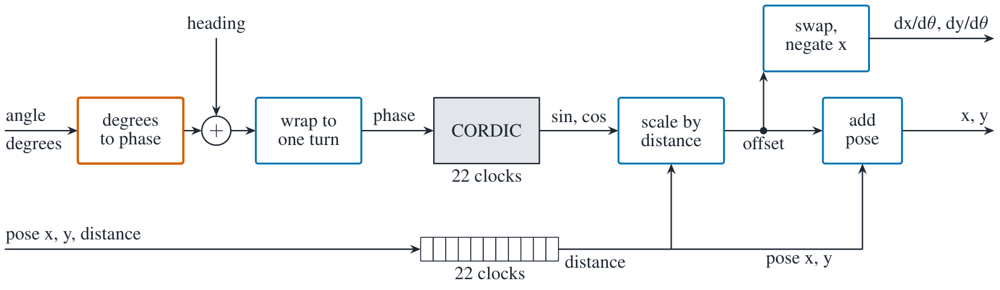
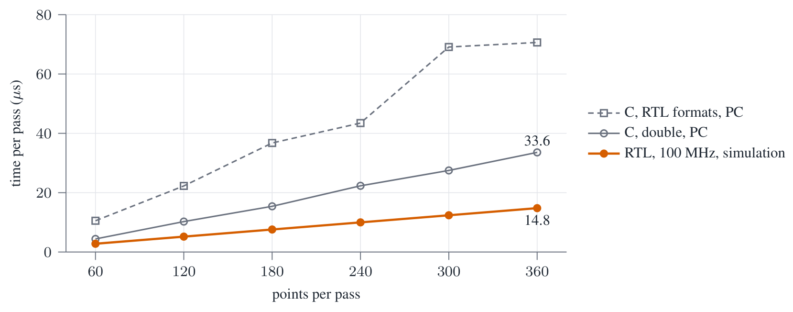
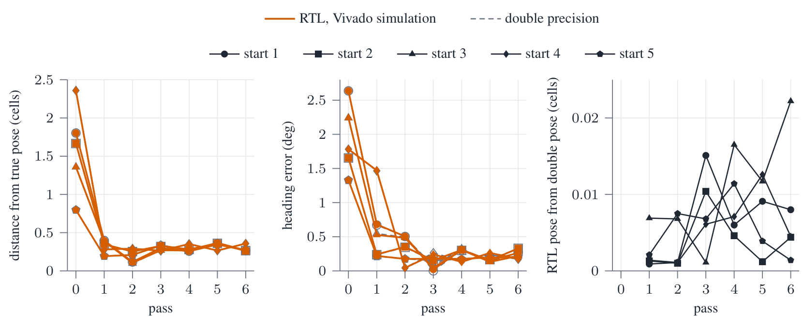

# Scan-Matching Accelerator

A mobile robot keeps track of where it is by matching each LiDAR scan against its map. Each scan match runs several Gauss-Newton iterations, called passes here, and each pass goes over every point of the scan. On a battery-powered robot this work falls on an embedded CPU that also runs the rest of mapping and navigation, and a larger processor is limited by power and heat. This accelerator moves the per-point part of every pass into FPGA logic beside the ARM cores of a Zynq UltraScale+ MPSoC: the logic takes the scan as a stream and returns nine sums, and the ARM cores solve a 3 x 3 system from them and update the pose.

I wrote the RTL and verified it in simulation. A 360-point pass takes 1,479 clocks, 14.8 us at 100 MHz, one point every 4 clocks; the same pass written in C takes 33.6 us on a laptop CPU (Intel Core i5-1335U). The nine sums match an integer model of the arithmetic bit for bit on 5,322 points, Gauss-Newton driven by them follows double precision to within 0.022 cells, and from starts up to 2 cells and 3 degrees off the matcher settles a median 0.04 cells and 0.06 degrees from the true pose. Built for POLARIS SIF 2026 (Semiconductor Innovation Festival, works category), December 2025 to January 2026, on a ZCU104 board.


The festival design ran on the ZCU104 at 100 MHz (Vivado 2022.2, worst setup slack 0.935 ns; 18,853 LUTs, 22,543 registers, 65 block RAM tiles and 84 DSP slices for the whole block design). The RTL in this repository builds on it: the coordinates keep their sign, back-to-back points are held at the input instead of dropped, the beam angle is converted to the CORDIC phase scale, and the map lookup reads one cell per clock. The results below come from the Vivado simulator.

## How a pass works

For one pass the control program writes the pose guess, the threshold and the map base and size into the accelerator's registers over AXI4-Lite and sets start. An AXI DMA reads the scan from DDR memory and streams it in, one 32-bit word per point (beam angle in degrees, distance in half cells). The ARM cores keep the map in block RAM through an AXI BRAM controller, and the accelerator reads it through the second port of the same memory, one 32-bit word per cell. After the last point the accelerator raises an interrupt. The program reads the nine sums, solves H dx = g and adds dx to the pose guess.

Each point goes through five stages. The clocks are those of the first point of a pass.

| Stage | What it computes | Clocks |
|---|---|---|
| 1 Coordinates | phase = heading + angle x 8192/180, wrapped into one turn; sine and cosine from a Xilinx CORDIC core; x = x0 + d/2 cos, y = y0 + d/2 sin, and their derivatives with respect to the heading | 24 |
| | FIFO, 8 entries | 1 |
| 2 Map lookup | cell index and fraction of (x, y); the four cells around the point, one read per clock | 6, then one point every 4 |
| 3 Value and slope | bilinear map value M and its slope; residual f = 255 - M; the point counts if M is at least the threshold | 2 |
| 4 Jacobian | J = [dM/dx, dM/dy, dM/dx dx/dheading + dM/dy dy/dheading] | 2 |
| 5 Sums | H += J^T J (6 terms), g += J^T f (3 terms), 64-bit accumulators | 2 |

A pass of N points takes 4 N + 39 clocks from start to interrupt.


Stage 1 turns the beam angle into a CORDIC phase, adds the heading, and scales the sine and cosine by the distance. The heading derivatives come from the same offset with its two components swapped and the new x negated.



## Design decisions

**Per-point work in logic, per-pass work on the CPU.** Each point contributes multiply-accumulate terms that do not depend on the other points, and their number grows with the scan, while the 3 x 3 solve, the convergence decision and the pose update happen once per pass. The per-point terms go through a pipeline in logic instead of running on the CPU one point after another, and the per-pass work stays on the ARM cores. The CPU writes the pose guess and the start bit, then reads the nine sums.

**One map read per clock, with points waiting in front.** The map lookup needs four cells per point from one block RAM port. Issuing one read per clock lets stage 2 take a new point every 4 clocks, against 26 clocks when each read waits for the previous one; a 360-point pass went from 9,397 to 1,479 clocks. Stage 1 takes 24 clocks, so several points are on their way to stage 2 at once. A counter, `in_flight`, counts the points between the input and stage 2, and TREADY stays high only while it is below the FIFO depth, so the FIFO never overflows and no point is dropped. With 8 entries stage 2 never waits: a 360-point pass takes 4,701 clocks with 2 entries, 2,369 with 4, 1,479 with 8 and 1,479 with 16.

## Number formats

| Quantity | Format |
|---|---|
| pose x, y; map coordinates | signed 32 bit, 14 fraction bits, map cells |
| heading | phase units, 8192 = pi, one turn = 16384 |
| beam angle, distance | unsigned 16 bit: degrees 0 to 359, half cells |
| map cell | unsigned 8 bit |
| M, f, threshold | signed 32 bit, 16 fraction bits |
| slope, J | signed 32 bit, 14 fraction bits (J3 per radian) |
| H11 to H23; H33; g | signed 64 bit, 28; 20; 20 fraction bits |

The angle is converted as angle x 2982616 / 2^16 with rounding, within 0.49 phase units (0.011 degrees) of angle x 8192/180 for every angle. The block RAM holds 256 KB, so a map has up to 65,536 cells, 256 x 256; every point that lands on such a map is within 361 cells of the sensor. In that range J3 fits its 32-bit word, and H33 is accumulated with 20 fraction bits so that 360 points at the largest slope stay inside 64 bits.

## Supported input

| Input | Behaviour |
|---|---|
| Scan length | up to 360 points; TLAST ends a shorter pass |
| Map | up to 256 x 256 cells; points outside the map read nothing and add nothing |
| Threshold | points with M below it add nothing |
| Start cleared during a pass | back to idle with the sums cleared; the next pass starts once the pipeline is empty |

## Results

All results below are from the Vivado 2025.2.1 simulator with a 100 MHz clock and a block RAM model with one clock of read latency, as in the ZCU104 design; the CORDIC core is generated for xc7a35tcpg236-1.

**Speed.** `experiments/pass_sw.c` runs the same pass in C, in double precision and in the accelerator's integer formats, on a laptop CPU (Intel Core i5-1335U, MSVC /O2, median of 15 runs). The accelerator at 100 MHz is faster at every scan length: 14.8 us for 360 points against 33.6 us in double precision and 70.6 us in the integer formats.



**Arithmetic.** `sim/check_model.py` ray-casts 20 scans of 360 beams from random poses on the test map, a 180 x 180 cell cut of the map this project built with slam_toolbox from the MIT Stata Center dataset, and runs each through the RTL: all nine sums of all 20 scans, 5,322 points, are identical to `sim/model.py`, with threshold 0 and with threshold 128.

**Bench.** `sim/tb_checks.v` passes all six of its checks: coordinates and phase for 360 beams in all four quadrants (within 0.0053 cells), identical sums for three stream patterns (one point at a time, TVALID held high, random gaps), start cleared mid-pass, a 100-point scan ending at TLAST, points outside the map, and a threshold above every map value.

**Matching.** `sim/fxfl.py` runs six Gauss-Newton passes from five starts, 0.8 to 2.4 cells and 1.3 to 2.6 degrees off, once with the RTL computing the sums and once in double precision: the two paths stay within 0.022 cells and 0.031 degrees of each other in all 30 passes. `experiments/convergence.py` matches scans from 30 random poses, starting 90 times up to 2 cells and 3 degrees off; on a map that draws the walls as lines with a crest of 255 (`experiments/make_ridge_map.py`), the matcher settles a median 0.038 cells and 0.059 degrees from the true pose.



## Registers

| Offset | Write | Read |
|---|---|---|
| 0x00 | bit 0 start | status: bits 31:16 point count, bit 5 stage 2 ready, bit 4 stage 1 ready, bits 3:2 pass state, bit 0 start |
| 0x04, 0x08 | pose x, y (cells, 14 fraction bits) | same |
| 0x0C | heading (phase units, 8192 = pi) | same |
| 0x10 | threshold on M (16 fraction bits) | same |
| 0x14 | map base address in the block RAM port | same |
| 0x18, 0x1C | map width, height (cells) | same |
| 0x20 to 0x4C | | H11, H12, H13, H22, H23, H33, 64 bit each, low word first |
| 0x50 to 0x64 | | g1, g2, g3 (K1, K2, K3 in the RTL), 64 bit each, low word first |

## Repository

```text
rtl/nlo_csm_accel_v1_0.v          top of the IP: AXI4-Lite, AXI4-Stream, block RAM port, interrupt
rtl/nlo_csm_accel_v1_0_S00_AXI.v  registers
rtl/nlo_csm_accel_v1_0_S00_AXIS.v stream input
rtl/NLO_CSM_Core_Pipeline.v       pass control, input admission, FIFO, the five stages
rtl/Stage1_Coord_Calc.v           coordinates and their heading derivatives
rtl/Stage2_Mem_Read.v             map lookup, one read per clock
rtl/Stage3_Gradient_Calc.v        map value, slope, residual
rtl/Stage4_Jacobian_Calc.v        Jacobian row
rtl/Stage5_Matrix_MAC.v           sums
ip/cordic_sin_cos.tcl             creates the CORDIC core
sim/run.sh                        builds and runs a bench in the Vivado simulator
sim/tb_checks.v                   self-checking bench
sim/tb_pass.v                     one pass from files, for the Python scripts
sim/model.py                      integer and double-precision models of a pass
sim/check_model.py                RTL against the integer model
sim/fxfl.py                       RTL against double precision over Gauss-Newton passes
sim/data/                         test map and ridge map
sim/logs/                         outputs of the runs below
experiments/pass_sw.c             the pass in C, timed
experiments/make_ridge_map.py     the ridge map
experiments/convergence.py        where the matcher settles
experiments/logs/                 outputs of the experiments
docs/                             figures
```

## Run

With Vivado on the PATH (or `VIVADO_BIN` pointing at its `bin` directory) and Python 3 with NumPy, from the repository root. The first run generates the CORDIC core into `build/`.

```sh
export PART=xc7a35tcpg236-1
sh sim/run.sh tb_checks              # six TEST lines, all PASS
python3 sim/check_model.py 20        # 20 of 20 scans identical
python3 sim/check_model.py 20 128    # 20 of 20 scans identical
python3 sim/fxfl.py
python3 experiments/convergence.py
cl /O2 experiments/pass_sw.c && pass_sw sim/data/map.pgm
```
