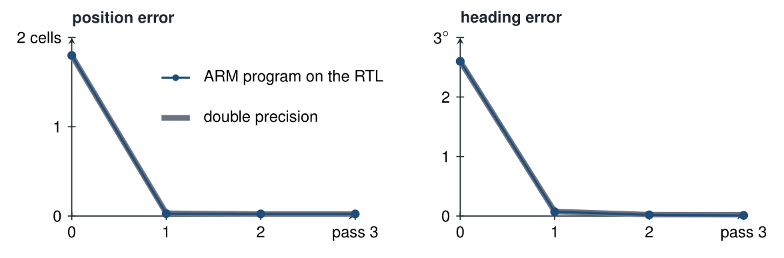

# Scan-Matching Accelerator

FPGA logic for Gauss-Newton LiDAR scan matching on an occupancy grid map, controlled by the ARM cores of a ZCU104 board (Zynq UltraScale+ MPSoC).

## Division of labor between the ARM cores and the logic

A mobile robot matches each LiDAR scan to its map to know where it is, and every pass of the matcher repeats the same arithmetic for every scan point. That per-point arithmetic runs in logic. The ARM cores keep the work done once per pass: they write the pose guess, read nine sums back, solve a 3 x 3 system and update the pose (`ps/nlo_csm_accel.c`).

## Five pipeline stages

Each scan point goes through five stages, from the beam to the update sums:

1. Coordinates of the point, with sine and cosine from a CORDIC core
2. The four map cells around the point, read from block RAM one after another
3. Map value, slope and residual, with a threshold on the map value
4. Jacobian row
5. Sums in 64-bit accumulators

In RTL simulation a point takes 56 clocks from the stream to the sums (24, 26, 2, 2 and 2 clocks per stage), and a 360-point scan takes 0.18 ms at 100 MHz.

## The program on the ARM cores

`ps/main.c` writes the map into block RAM through the AXI BRAM controller, one cell per word. For each scan, it packs every beam into one stream word, with the angle in degrees in the upper half and the range in half cells in the lower half, and runs the passes in `ps/nlo_csm_accel.c`. A pass writes the pose guess over AXI4-Lite in the logic's fixed-point formats (map cells in Q14, heading in 65,536 steps per turn), sends the scan through the AXI DMA, waits until the logic reports completion, reads the nine 64-bit sums and solves for the pose step. The passes stop when the changes in x and y are each below 0.01 cells and the heading change is below 0.01 degrees, or after six passes.

## Checked against double precision

The program in `ps/` ran in an RTL simulation of the accelerator: through DPI-C, its register writes and reads became AXI4-Lite transfers, its DMA transfer supplied the stream and its map writes filled the block RAM. In a test room of 128 x 128 cells with a 360-point scan, initial errors of 1.8 cells and 2.6 degrees decrease to 0.02 cells and 0.01 degrees in three passes. The same passes computed in double precision end with errors of 0.02 cells and 0.02 degrees.

## Build

`ip/cordic_sin_cos.tcl` creates the CORDIC core of stage 1 (`vivado -mode batch -source ip/cordic_sin_cos.tcl -tclargs OUT_DIR`). The top module is `rtl/nlo_csm_accel_v1_0.v`. On the ZCU104 the design met timing at 100 MHz.

`ps/` is a Vitis bare-metal application for the Cortex-A53 cores, linked with the math library. `lidar_dataset.h` contains the map and the scans and is generated from the recorded data; `ps/main.c` documents its contents.
