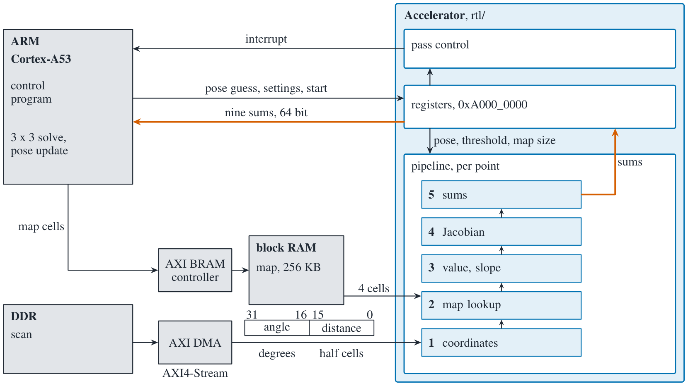
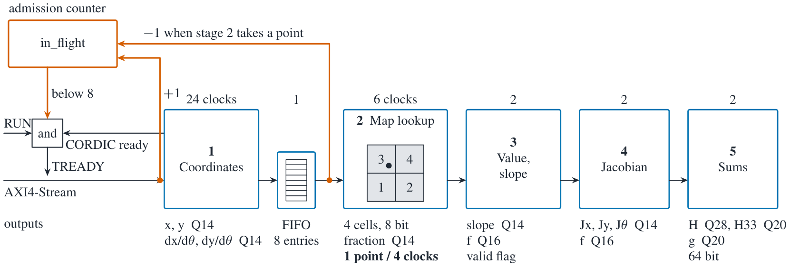

# Scan-Matching Accelerator

FPGA logic for Gauss-Newton LiDAR scan matching on an occupancy grid map, controlled by the ARM cores of a ZCU104 board (Zynq UltraScale+ MPSoC). Built for POLARIS SIF 2026.

## Division of labor between the ARM cores and the logic

A mobile robot matches each LiDAR scan to its map to know where it is, and every pass of the matcher repeats the same arithmetic for every scan point. That per-point arithmetic runs in logic. The ARM cores keep the work done once per pass: they write the pose guess, read nine sums back, solve a 3 x 3 system and update the pose.



## Five pipeline stages

Each scan point goes through five stages, from the beam to the update sums:

1. Coordinates of the point, with sine and cosine from a CORDIC core
2. The four map cells around the point, one block RAM read per clock
3. Map value, slope and residual
4. Jacobian row
5. Sums in 64-bit accumulators

Stage 2 takes a new point every 4 clocks. Points leaving stage 1 wait in an 8-entry FIFO, and the stream is accepted only while there is room, so no point is dropped.



## Checked in simulation and on the board

In RTL simulation, the nine sums match an integer model of the arithmetic bit for bit on 20 ray-cast scans (5,322 points). A self-checking testbench covers all four quadrants, three stream patterns, an aborted pass, a short scan, points outside the map and the threshold on the map value. On the ZCU104 the design met timing at 100 MHz.

## Run

Run the checks from the repository root, with Vivado on the PATH and Python 3 with NumPy:

```sh
export PART=xc7a35tcpg236-1
sh sim/run.sh tb_checks
python3 sim/check_model.py 20
```
